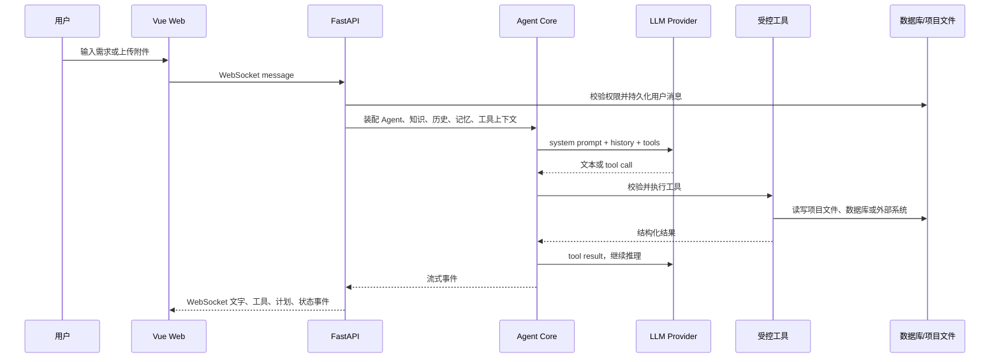

# Agents Universe 实现原理：从聊天到可审计的企业智能体

> 本文以仓库当前代码为准，面向想理解和扩展 Agents Universe 的开发者。它既解释概念，也标出实际代码入口，避免把 README 的产品描述误当成已经自动发生的魔法。

## 1. 先用一句话理解它

Agents Universe 是一个把大语言模型（LLM）放进受控工作环境的全栈平台：

1. 用角色定义、项目知识、会话历史和个人记忆组成模型上下文；
2. 让模型通过标准化的 tool/function calling 选择工具；
3. 在平台代码中执行工具、记录事件、把结果再交回模型；
4. 通过任务计划、权限、沙箱、加密和持久化，让过程可见、可控、可追溯。

因此，模型负责的是“理解、决策、生成下一步”；真正读文件、访问 Jira、调用 API、写知识、创建任务的，是 Python 工具实现。这个分工是理解整个项目的钥匙。

## 2. 为什么它不只是聊天框

普通聊天通常是：

```text
用户输入 -> 模型回答 -> 展示文本
```

本平台的一个回合更接近：



模型不拥有主机权限，也不直接持有业务密钥。它只能提出一次有 JSON Schema 约束的工具调用，平台根据当前用户、项目和会话构造的 `ToolContext` 决定该调用实际能做什么。

## 3. 仓库与运行时分层

| 层次 | 目录 | 责任 |
| --- | --- | --- |
| Web UI | `packages/web` | Vue 3 三栏界面、流式状态、项目/会话/记忆面板 |
| API 服务 | `packages/api` | FastAPI REST/WebSocket、鉴权、数据库模型、密钥保管、回合持久化 |
| Agent 引擎 | `packages/agent-core` | 模型抽象、Agent loop、工具、知识加载、压缩、沙箱 |
| 可复用行为资产 | `agents`、`workflows`、`knowledge` | 角色提示词、技能、工作流、框架知识和项目模板 |
| 每个项目的工作区 | `PROJECTS_ROOT/{slug}` | 项目级 agent/skill/workflow/knowledge、测试和临时产物 |

其中最重要的边界是：`agent-core` 是不依赖 HTTP 的 Python 库；API 层负责把 Web、数据库与用户身份接到这个库上。这使得 Agent 循环可以被测试，也便于未来接入命令行或后台任务入口。

## 4. 一次用户请求如何真正执行

主调用链为：

```text
packages/web/src/composables/useWebSocket.ts
  -> /ws/conversations/{conversation_id}
  -> packages/api/src/api/websocket/handlers.py
  -> packages/api/src/api/services/agent_turn.py::run_turn
  -> packages/agent-core/src/agent_core/agent.py::Agent.run
  -> Agent._run_loop
```

### 4.1 前端：不仅接收文字，也接收运行状态

`useWebSocket.ts` 为每个会话维护连接、心跳、断线重连和历史补偿。连接恢复后，前端会重新拉取消息、任务和最近一次运行记录，而不是假设流式连接永不丢失。这解释了为什么 UI 能展示“模型已选择”“知识已加载”“工具调用”“计划任务”和持续文本，而不只是一个 loading 圈。

### 4.2 API：先确定“谁、在哪个项目、用哪个模型”

`run_turn()` 会先验证会话归属、会话状态和项目状态，再加载当前用户可用的模型凭据。随后它：

- 解析会话默认 Agent，或处理 `@Agent` 仅当前轮切换；
- 加载该角色的 Markdown frontmatter 与正文；
- 构造项目级 `ToolContext`，其中含 `project_id`、`user_id`、项目根目录、数据库会话、附件索引和集成配置；
- 装载项目知识、对话历史、个人记忆、未完成计划；
- 先持久化用户消息，再创建可恢复的 `ConversationRun`；
- 创建短生命周期 `Agent` 并把事件转发到 WebSocket，同时将结果与工具活动写回数据库。

这里“每回合新建 Agent”很重要：Provider HTTP client、工具上下文和动态注入的 MCP 连接都不会被无边界地跨会话复用。

### 4.3 Agent：提示词装配器 + 工具循环

`Agent.run()` 的步骤可概括为：

1. 选定显式模型或自动路由后的模型，并发出 `model_selected` 事件；
2. 根据用户消息激活最多三个触发式技能；
3. 建立 system prompt，把本轮激活的技能正文一并加入；
4. 按供应商上下文窗口压缩历史；
5. 把 system、history、当前用户消息（可能含图像）和工具 JSON Schema 发送给 Provider；
6. 进入 `_run_loop`：模型要求工具时执行工具，追加 tool result，再调用模型；模型自然结束时输出最终回答。

这正是常说的 ReAct/tool-use 模式的工程化版本：模型在“思考/决定”与“行动/观察”之间循环。不同点是平台把行动包在明确的工具边界中，并把每一步做成 UI 事件和可保存记录。

## 5. 多模型不是简单换 API Key

`agent_core.providers.base.LLMProvider` 统一了不同厂商的核心能力：

- `complete()` 与 `stream()`；
- 统一的 `Message`、`ToolDefinition`、`StreamChunk`；
- 标准化结束原因，例如 OpenAI 的 `tool_calls` 与 Anthropic 的 `tool_use` 都映射到 `StopReason.TOOL_USE`；
- 模型上下文长度、视觉能力、工具调用能力。

`providers/registry.py` 延迟加载 Anthropic、OpenAI、Azure OpenAI、Google Gemini 的实现。好处是上层 Agent 不必理解各家响应格式；代价是要持续维护各供应商的 tool-call 和流式协议差异。

系统还根据上下文窗口计算可用历史预算，并在请求字节数过大时压缩或降级知识上下文。这里值得区分两个概念：`token_budget` 更多是产品展示和会话预算；真正能否发出请求仍受所选模型 `context_window`、输出保留和请求大小限制控制。

### 5.1 模型调用的统一契约

先区分两层通信：浏览器通过 WebSocket 与本系统后端交换消息和运行事件；后端的 Provider 再通过模型厂商的 Python SDK 发起 HTTP 请求。浏览器的 WebSocket 消息不是直接转发给 LLM 的请求体，模型 API Key 也不需要交给浏览器。

Agent 引擎使用的内部接口定义在 [LLMProvider](../packages/agent-core/src/agent_core/providers/base.py#L113)。无论最终调用哪家厂商，上层都先构造两组数据：

| 内部对象 | 字段 | 实际含义 |
| --- | --- | --- |
| `Message` | `role`、`content` | 一条 system、user、assistant 或 tool 消息；内容可以是文本或多模态内容块 |
| `Message` 的工具调用关联 | `tool_calls`、`tool_call_id`、`name` | 将模型提出的工具调用与平台返回的执行结果对应起来 |
| `ToolDefinition` | `name`、`description`、`parameters` | 工具名称、用途说明和参数 JSON Schema；不是工具实现代码 |
| `StreamChunk` | `delta`、`tool_call_delta`、`stop_reason`、`usage` 等 | 适配器统一后的输出增量、工具参数片段、停止原因和 token 用量 |

交互主循环调用 `provider.stream(messages, tool_defs, max_tokens=...)`；Provider 将这些对象翻译成厂商协议。另一个接口 `complete()` 返回完整结果，可用于不需要向用户逐字输出的调用。这里的“流式”主要指响应分段返回，并不意味着每次只向模型发送刚新增的几个字。

例如，[OpenAIProvider](../packages/agent-core/src/agent_core/providers/openai.py#L56) 当前调用的是 `client.chat.completions.create(...)`，不是 Responses API，也没有在此接口里创建一个由厂商代管历史的 conversation。它把传入的整个消息列表转成 `messages`，工具 Schema 转成独立的 `tools` 字段；流式调用设置 `stream: true` 和 `stream_options: {"include_usage": true}`。

输出参数也会在适配器内转换：普通 OpenAI 模型发送 `max_tokens`、`temperature`；按名称识别的 o 系列或 GPT-5 推理模型改用 `max_completion_tokens`，不发送 `temperature`，且仅在配置了推理力度时加入 `reasoning_effort`。因此，“系统内部调用参数相同”不等于“所有厂商收到完全相同的 JSON”。

### 5.2 用户只输入一句话，后台还会附带什么

以用户输入“帮我分析订单接口为什么报错”为例，正常对话的第一笔主模型请求不是只发送这句话，而是：

```text
messages = [system(本轮组装的上下文)]
         + history(当前会话的历史消息，必要时已压缩)
         + [user(当前输入，可能附带附件内容和本轮路由说明)]

tools = 当前 Agent 实际可用工具的名称、说明、参数 JSON Schema
```

这个组装发生在 [Agent.run](../packages/agent-core/src/agent_core/agent.py#L738)。`system(...)`、`user(...)` 是这里用于说明角色的记法，实际在 Python 中是 `Message` 对象，在 OpenAI 请求中是 JSON 对象。**没有单独名为 `knowledge`、`memory`、`workflow` 的模型 API 字段；这些信息主要被格式化为文本，放入 system 消息。**

| 上下文 | 从哪里来、什么时候带上 | 发给模型的形式 |
| --- | --- | --- |
| 当前 Agent 的角色指令 | 解析本轮选中的 Agent 定义；可以是会话默认角色或本轮 `@` 指定角色 | system 开头的角色正文，不是原样上传整个 Agent 文件 |
| 工作区和执行约定 | 引擎生成的工作区根路径、目录约定、项目隔离、知识写入优先级、交互与增量执行规则 | system 中的普通文本段落 |
| 可用工具行为说明 | 当前实际注册的工具，含成功接入且被授权的 MCP 工具 | system 中的 `Available Tools & Behaviors`；详细参数另放 `tools` |
| primary 知识正文 | 当前项目知识目录中符合 Agent `knowledge` 过滤条件、非延迟加载且未超限的文件 | system 的 `Project Knowledge`，按 `### [[slug]]` 拼接全文；不是只挑与这句话相似的几段 |
| 超大 primary 知识 | 文件过大，或请求降级时被移出全文区 | system 的 `Additional Knowledge` 只列 `[[slug]]`，提示通过工具读取 |
| 个人记忆 | 当前用户、未归档、全局或当前项目范围；按创建时间倒序最多 50 条 | system 的 `Personal Memories`，例如 `- [project][preference] 优先用中文回答` |
| 已保存的任务计划 | 当前会话已有的任务记录，包含完成、进行中、失败等状态 | system 的 `Current Task Plan`；完成摘要或失败原因最多附带前 200 个字符 |
| 待续任务文件 | 会话有 pending/running 任务时，扫描其媒体目录中的非图片、可读 UTF-8 且少于 5,000 字符的文件 | system 的 `Pending Task Files`，按文件名和内容拼接；不是扫描整个项目目录 |
| 工作流目录 | 当前 Agent 声明、且在全局或项目工作流注册表中能找到的工作流 | system 的 `Available Workflows` 只列 slug 和说明；步骤正文需要模型调用 `filesystem read_file` |
| 本轮触发的技能 | 根据当前用户输入匹配触发条件，最多 3 个 | system 的 `Active Skill: <slug>` 加技能正文；不是把所有技能库一次性塞入请求 |
| 本轮动态任务计划 | Agent 执行中更新的任务列表 | system 动态区的 `Current Task Plan`，在后续请求中反映新状态 |
| 已加载的 detail 知识 | 之前执行过 `knowledge_rw load` 且仍保持加载状态的内容；新回合会从加载事件恢复 | system 的 `Dynamically Loaded Knowledge`，包含正文 |
| 尚未加载的 detail 目录 | 符合过滤和项目/全局范围的延迟知识条目，包括磁盘回退发现的条目 | system 的 `Available Detail Knowledge` 表格，包含 slug、summary、parent，不含全文 |
| 任务来源优先级 | 当前输入命中 Jira/PR 等来源规则时按需追加 | system 的 `Task Source Priority` 指令 |
| 当前会话历史 | 数据库中这个 conversation 的消息；不会加载其他会话全部聊天 | `messages` 中独立的 user、assistant、tool 消息，而不是全部拼进 system |
| 本轮用户输入和附件 | 当前输入；附件先经后端校验、解析，再构造消息 | 最后一条 user 的字符串或多模态内容块；`@` 切换时可能追加说明其他 Agent 身份的系统注记文本 |

表中的可选项不存在时，相应段落就不会出现。新会话可能没有历史、记忆或计划，但仍会发送角色规则、可用工具和该角色可见的项目知识，所以“一句话”的请求也可能很大。

另有两个容易误解的边界：

- `knowledge_level: detail`，以及 `knowledge_level: auto` 且有 `parent` 的文件属于延迟知识；`knowledge_role: log` 或规范日志 slug `system/history` 默认既不发送正文，也不进入 detail 目录，只有显式读取或加载后才可能进入上下文。
- 数据库 session、完整 `ToolContext`、用户 JWT、模型 API Key、密钥保险库对象不会被整体序列化进 messages。它们留在后端执行工具或完成鉴权；但写入知识正文、聊天或工具返回值的业务数据，确实可能随上下文发给所选模型服务。

### 5.3 system 消息内部是什么样

[提示词构造函数](../packages/agent-core/src/agent_core/agent.py#L890) 把静态部分和动态部分连接成一个字符串。下面按代码中的拼接顺序展示结构；方括号内是解释性占位，不是框架固定发送的文字，可选段落会省略：

```text
[当前 Agent 的角色正文]

## Workspace Convention
[项目根路径、目录规则、禁止跨项目访问等]
[知识写入优先级]

## Interaction Style
[工具调用前后要向用户说明进展]

## Available Tools & Behaviors
[当前工具名、简要用途及使用约束]

## Incremental Execution Protocol
[先规划、分步修改、验证、提交前确认等规则]

## Project Knowledge
### [[system/context]]
[已加载知识全文]
### [[technical/api-map]]
[另一份已加载知识全文]

## Additional Knowledge (use knowledge_rw read)
[[超限知识的 slug 列表]]

## Personal Memories
[适用的个人记忆条目]

## Current Task Plan
[从数据库恢复的任务状态和简短结果]

## Pending Task Files
[待续任务文件内容，如有]

## Available Workflows
[工作流 slug 和 description，以及读取步骤正文的提示]

## Active Skill: [本轮命中的技能 slug]
[技能正文，最多 3 个技能]

## Current Task Plan
[本轮动态计划，如有]

## Dynamically Loaded Knowledge
[已显式加载且未卸载的知识正文]

## Available Detail Knowledge
| Slug | Summary | Parent |
[尚可按需加载的知识目录]

## Task Source Priority
[本轮命中来源优先级规则时追加的指令]
```

这里的 Markdown 标题、表格、`[[slug]]` 对模型而言都是字符串里的字符。模型不会因为看见一个 slug 就自动读到文件；只有正文已经拼入请求，或之后通过工具取得正文，它才真正获得这部分内容。跨引用不是向量、文件句柄，也不是模型服务可以直接打开的本地路径。

“静态部分缓存”也只是当前 Agent 实例避免重复拼接字符串的本地优化，**不表示以后请求省略这部分文本**。最终仍由 Provider 将当前整份消息上下文发出。

### 5.4 从浏览器的一句话，到实际 HTTP 请求体

**第一层：浏览器发给本系统。** [ChatPanel](../packages/web/src/components/chat/ChatPanel.vue#L391) 在会话 WebSocket 上发送的 JSON 类似：

```json
{
  "type": "message",
  "content": "帮我分析订单接口为什么报错",
  "agent_id": "tech-lead",
  "config_id": "<selected-model-config-id>"
}
```

有附件时增加 `attachments` 数组，携带此前上传所得的引用。`agent_id` 在这里是 Agent slug，`config_id` 是本系统的模型配置标识，不是厂商的模型名。会话身份来自 WebSocket 路径及后端鉴权；浏览器不需要在每次发送时自行收集知识、记忆和历史。

**第二层：后端发给模型服务。** 后端解析配置得到 Provider、模型名、URL、服务端凭据等，再生成请求。以配置了示例网关、选择 `gpt-4o`、没有附件且已有两条历史消息为例，HTTP 外层为：

```http
POST /v1/chat/completions HTTP/1.1
Host: llm.example.com
Authorization: Bearer <SERVER_SIDE_MODEL_API_KEY>
Content-Type: application/json
```

下面是便于阅读的请求体示例，不是线上抓包：system 的业务内容和历史是虚构的，并省略了部分提示词段落；只展示一个工具，但 `filesystem` 的参数 Schema 按当前实现展开。真实请求会发送完整的当前 system 和全部可用工具定义。

```json
{
  "model": "gpt-4o",
  "messages": [
    {
      "role": "system",
      "content": "你是项目技术负责人。\n\n## Workspace Convention\n工作区根目录：/workspaces/orders-demo。\n\n## Project Knowledge\n### [[technical/api-map]]\n订单接口为 POST /api/orders；错误日志位于 .tmp/work/order-error.log。\n\n## Personal Memories\n- [global] 使用中文回答。\n\n## Available Detail Knowledge\n| Slug | Summary | Parent |\n| technical/order-api-detail | 订单接口参数与错误码 | technical/api-map |"
    },
    {
      "role": "user",
      "content": "这个会话主要排查订单服务。"
    },
    {
      "role": "assistant",
      "content": "接下来会结合接口定义和错误日志排查。"
    },
    {
      "role": "user",
      "content": "帮我分析订单接口为什么报错"
    }
  ],
  "tools": [
    {
      "type": "function",
      "function": {
        "name": "filesystem",
        "description": "Read, write, list, or delete files within the current project directory. All paths must be relative to the project root or knowledge directory. Writes and reads of definition files (agents/*.agent.md, skills/*.md, workflows/*.workflow.md) also return an advisory `definition_check` block.",
        "parameters": {
          "type": "object",
          "properties": {
            "operation": {
              "type": "string",
              "enum": ["read_file", "write_file", "list_dir", "delete_file", "create_dir"],
              "description": "The filesystem operation to perform"
            },
            "path": {
              "type": "string",
              "description": "Relative path from the project root"
            },
            "content": {
              "type": "string",
              "description": "Content to write (for write_file only)"
            }
          },
          "required": ["operation", "path"]
        }
      }
    }
  ],
  "max_tokens": 16384,
  "temperature": 0.0,
  "stream": true,
  "stream_options": {
    "include_usage": true
  }
}
```

阅读这段 JSON 时，应注意：

- `\n` 是 JSON 中的换行表示；解码后 system 就是 5.3 所示的多段 Markdown 文本。中文可能直接以 UTF-8 发送，也可能由序列化器转义，语义相同。
- 新会话没有示例中的两条历史，但 system 和 tools 仍然存在。当前用户消息在历史之后追加一次；API 在持久化本轮输入前已加载历史，正常路径不会把同一句输入重复放两遍。
- `tools` 是能力声明，不是执行结果，不含 Python 函数源码。模型根据工具名称、说明和参数 Schema 决定是否发起调用；真正的执行与安全检查仍在本系统。
- Agent 默认 `max_tokens=128000`，但普通 OpenAI 模型会在适配器中降到至多 `16384`；o 系列/GPT-5 使用 `max_completion_tokens`，不发送 `temperature`，GLM 的输出上限处理也有单独分支。因此示例数值不是所有模型的统一限制。
- 当前 OpenAI 主调用没有显式发送 `tool_choice`、`response_format`、`top_p` 或 `parallel_tool_calls`，不要把 SDK/服务端默认行为误写成平台主动设置的参数。
- 自定义 OpenAI `base_url` 模式会在末尾没有 `/v数字` 时补 `/v1`；`full_url` 模式若收到完整 `/chat/completions` 地址，会先去掉该后缀，再由 SDK 加回。API Key 在鉴权头中，`config_id` 和本系统的 `conversation_id` 不作为这里的模型请求字段发送。

### 5.5 有附件时，user 不再只是字符串

[build_user_content](../packages/agent-core/src/agent_core/agent.py#L162) 在没有附件时直接返回用户字符串；有附件时返回内容块数组。后端先读取并准备附件，再由 Provider 翻译块格式：

| 附件类型 | 后端准备方式 | 模型实际得到什么 |
| --- | --- | --- |
| 可解码为 UTF-8 的上传文本 | 内联最多 20,000 字符，超出部分标记截断 | user 中的 text 块，包含 `### Attachment: 文件名` 和正文 |
| 支持的图片 | 单张不超过 3 MiB，且 Provider 支持视觉时转成 Base64 | user 中的图像内容块，不是要求模型访问本系统的受保护下载 URL |
| 二进制附件、超限图片或不支持视觉 | 保留名称、媒体类型、大小、相对路径 | user 中的文本引用，之后需要工具读取/解析；此处没有通用的 PDF/Excel 全文解析步骤 |

例如 OpenAI 最终可能收到下面这一条 user 消息；Base64 是占位符，不是有效图片数据：

```json
{
  "role": "user",
  "content": [
    {"type": "text", "text": "帮我分析订单接口为什么报错"},
    {"type": "text", "text": "### Attachment: error.log\nPOST /api/orders returned 500"},
    {
      "type": "image_url",
      "image_url": {"url": "data:image/png;base64,<BASE64_IMAGE_BYTES>"}
    }
  ]
}
```

引擎内部的图片块其实是 `{"type":"image","media_type":"image/png","data":"..."}`。OpenAI 转成上面的 data URL；Anthropic 转成 `image.source`，其中有 `type=base64`、`media_type`、`data`；Gemini 转成 `inline_data`，包含 `mime_type` 和数据。

历史消息也可能重新带附件：`_load_history()` 会尝试从仍然存在的磁盘文件恢复文本，且只为最近 4 个带图片的历史用户消息恢复视觉块。旧图片或文件缺失时退回文本引用。用户上传的内存内容不等于永久的模型记忆，路径引用本身也不代表模型已经看过文件。

### 5.6 工具执行以后，下一笔请求增加什么

主模型第一次响应不一定给出最终答案。它可能先提出读取日志的工具调用。下面是流式片段合并后形成的 assistant 消息，而不是浏览器事件或完整的厂商 HTTP 响应外壳：

```json
{
  "role": "assistant",
  "content": "我先读取订单接口的错误日志。",
  "tool_calls": [
    {
      "id": "call_read_log_1",
      "type": "function",
      "function": {
        "name": "filesystem",
        "arguments": "{\"operation\":\"read_file\",\"path\":\".tmp/work/order-error.log\"}"
      }
    }
  ]
}
```

`arguments` 在 OpenAI 协议中是 **JSON 编码的字符串**，不是嵌套对象。引擎会汇总流式参数片段、解析 JSON、查找当前工具，再执行 `tool.execute(args, tool_context)`。工具负责实际文件访问、权限、路径或其他业务限制。

执行结果随后作为 tool 消息加入内存消息列表。以下结果仅保留示意字段，真实工具可能返回更多元数据：

```json
{
  "role": "tool",
  "tool_call_id": "call_read_log_1",
  "content": "{\"path\":\".tmp/work/order-error.log\",\"content\":\"Database connection timed out\"}"
}
```

`tool_call_id` 必须与前面的调用 ID 对应；`content` 通常也是结构化工具结果经 JSON 序列化得到的字符串。工具失败时也可以回填 `{"error":"..."}`，让模型看到失败原因，而不是假装执行成功。

接着引擎再次调用 Provider，发送的是：

```text
请求 1：system + 已有历史 + 本轮 user                         + tools
请求 2：system + 已有历史 + 本轮 user + assistant(tool_calls)
                                  + tool(执行结果)          + tools
请求 3：上述上下文 + 下一组 assistant/tool 消息               + tools
```

这里的 `+ tools` 表示独立请求字段，不是 messages 中的一条消息。**不是仅将 tool result 单独发给模型，而是重新发送当前保留的整组 messages 和工具定义。** 只有模型在读取结果后继续生成，才会得到“数据库连接超时”之类的分析结论。

还有三个重要区别：

- 普通 `filesystem read_file`/`knowledge_rw read` 把读取内容作为工具结果带回；`knowledge_rw load` 还会把知识加入动态上下文，并触发 system 重建。下次请求可能同时包含更新后的 system 和工具结果。写入、卸载或删除知识也会使提示词重新构建。
- 同一轮中，工具结果先存在内存 messages，向模型发送的结果与前端展示或持久化的裁剪结果不一定完全一致。下一轮用户消息到来时，API 会从数据库重建历史：把 assistant 记录中的工具活动重新转成 `tool_calls`，并补齐对应 tool 消息；不会无限保存并原样重放每个网络片段。
- 下一轮用户输入会重新加载项目上下文、记忆和已保存计划。动态知识的加载事件也会恢复，因此它可以跨用户回合保留；这与模型厂商代管会话历史是两回事。

### 5.7 换一家模型，哪些字段会改变

统一 `Message` 不是所有供应商都原生接受的协议。各适配器的转换关系如下：

| 内容 | OpenAI / Azure OpenAI | Anthropic 原生 Messages API | Google Gemini |
| --- | --- | --- | --- |
| system 文本 | `messages` 内的 `role: system` | 从消息数组移出，放到顶层 `system` | SDK 的 `config.system_instruction`，REST 中为 `systemInstruction` |
| 用户与历史 | `messages[].role/content` | `messages[].role/content` | `contents[].role/parts`；assistant 改名为 `model` |
| 工具定义 | `tools[].type=function` 与 `function.parameters` | `tools[].name/description/input_schema` | SDK `Tool(function_declarations=...)`，REST 中为 `tools[].functionDeclarations` |
| 模型工具调用 | assistant 的 `tool_calls`，参数是 JSON 字符串 | assistant 内容块中的 `tool_use`，参数在 `input` 对象中 | model parts 中的 `function_call`，参数在 `args` 对象中 |
| 工具结果 | 独立 `role: tool`，使用 `tool_call_id` | user 内容块中的 `tool_result`，使用 `tool_use_id` | user parts 中的 `function_response`，使用名称和 `response.result` |
| 主流式调用入口 | `chat.completions.create(stream=True, ...)` | `messages.stream(...)` | `aio.models.generate_content_stream(...)` |

Gemini 表中的 `system_instruction`、`function_call`、`function_response` 等是 Python SDK 侧命名；SDK 序列化到 REST JSON 时采用 `systemInstruction`、`functionCall`、`functionResponse` 等字段。不要把 SDK 的关键字参数与最终 HTTP JSON 命名混为一谈。

例如，仅截取“system + 当前输入”这部分，Anthropic 的结构是：

```json
{
  "system": "角色规则、知识、记忆、技能等拼接后的完整文本",
  "messages": [
    {"role": "user", "content": "帮我分析订单接口为什么报错"}
  ]
}
```

Gemini 对应的 REST 内容结构是：

```json
{
  "systemInstruction": {
    "parts": [{"text": "角色规则、知识、记忆、技能等拼接后的完整文本"}]
  },
  "contents": [
    {"role": "user", "parts": [{"text": "帮我分析订单接口为什么报错"}]}
  ]
}
```

这两个片段不是完整可发送请求，实际还包含相应的模型选择、工具定义和生成参数。其他协议差异包括：

- Azure OpenAI 使用 `AsyncAzureOpenAI`，`model` 对应部署名。典型路径为 `/openai/deployments/<deployment>/chat/completions?api-version=<version>`，鉴权头为 `api-key`；构造器默认 API 版本为 `2024-08-01-preview`，可由配置覆盖。messages/tools 的转换复用 OpenAI 格式。
- Anthropic 原生接口使用 SDK 发送到 `/v1/messages`。当前实现将非官方主机的自定义 `base_url` 视为 Bedrock 兼容网关，走 raw HTTP 分支和相应的 invoke 路由，或按 `full_url` 使用完整端点；不能假设每个 Anthropic 配置都发送到 `/v1/messages`。
- Anthropic 可能额外发送 `thinking`；启用时不发送 `temperature`。同一轮工具循环需要的带签名 thinking 块会保存在内存并按协议回放，签名块不从数据库历史恢复。它不是另一套持久知识库。
- Gemini 把输出上限、温度、system 和工具放进 `GenerateContentConfig`；对支持的模型可增加 `thinking_config.include_thoughts`。最终 URL/API 版本由 SDK 和 `base_url` 配置决定。
- Anthropic/Gemini 会合并连续同角色消息及相邻工具结果，以适应各自的多轮协议；因此网络上的消息数量不一定等于引擎内部 `Message` 数量。

### 5.8 太长的上下文怎样处理

“每次发送当前上下文”不等于“永远发送全量历史、全部文件”。进入主请求前后有不同层次的限制：

1. **历史读取限制。** `_load_history()` 默认先查询最近 200 条数据库消息，并用 50 MiB 的正文及 thinking 大小保护保留最近一段历史。这是数据库读取保护，不是模型 API 的请求大小上限；补齐工具结果后，内部消息数可能超过 200。
2. **知识加载限制。** primary 单文件大小上限为 512 KiB；动态加载区域最多 10 个文件、合计 256 KiB。超限时不能假设所有知识正文仍会进入 system，模型可能只拿到目录或加载失败说明。
3. **上下文窗口预算。** 引擎估算 system、当前用户输入和工具 Schema 的 token，并预留 `min(agent.max_tokens, 16384)` 的输出空间，剩余部分作为历史预算。模型窗口取配置覆盖或按名称匹配的默认值，最终仍受服务端实际限制约束。
4. **历史摘要。** 历史估算超过其预算的 60%，或请求字节检查要求强制压缩时进入压缩处理。多于 8 条消息时，对早期消息调用 `provider.complete(..., tools=None)` 生成摘要，通常保留末尾 8 条内部消息，并调整边界以免拆坏工具调用对；不超过 8 条时只截断过大的工具消息，不调用摘要模型。这里是 8 条消息，不是 8 个用户回合。摘要输入最多 60,000 字符；自动摘要使用本轮所选 Provider。
5. **请求体字节保护。** 默认按 8 MiB 的估算门槛检查 messages 与 tools，可用 `AGENT_MAX_REQUEST_BYTES` 调整。token 估算和实际序列化字节不是同一件事，尤其是中文转义、大 JSON 和 Base64 图片。
6. **逐级降级。** 超限时先截断过大的工具消息；仍不够，再尝试摘要早期历史、将最大的 primary 正文逐个降为目录引用、把图像块降为文本引用。仍然放不下则向用户报告错误，而不是认为扩大 UI 的 token budget 就能解决。

自动压缩后的主请求历史大致变成：

```text
system: 本轮角色与项目上下文
user: [Earlier conversation summary - this is automated context, not a user message]
      早期对话摘要
assistant: Understood, I have the earlier conversation context.
[保留的最近消息，包括必要的工具调用与结果]
user: 本轮用户输入
```

**摘要是带明确标记的 user + assistant 消息对，不是新的 system 消息。** 这样不会让 Anthropic/Gemini 适配器将摘要当作 system 而覆盖角色与项目上下文。这条自动压缩路径只调整本轮用于发送的内存历史，不改写数据库原始聊天记录。摘要为空或调用失败通常保留原历史；自动压缩超时则走保留最近消息的回退路径。

知识缓存、静态提示词缓存都在本系统进程侧，并不使这些文本从请求中消失。当前这些调用也没有显式配置厂商的 `cache_control` 或 `cached_content`；服务端是否命中前缀缓存、如何计费，应以供应商返回和实际配置为准。

### 5.9 一句话可能对应哪些独立的模型调用

除了主回答，普通交互路径上还可能有辅助请求，各自只带它需要的上下文：

| 调用 | 何时发生 | 携带的上下文 |
| --- | --- | --- |
| 自动选模分类 | 用户选择自动模型，且配置了可用的模型档位时 | 分类专用 system + 最近 8 条记录中筛选出的 user/assistant 文本 + 当前输入；历史总字符预算 4,000，单条最多 2,000，当前输入最多 4,000；无工具 Schema，不加载整套项目知识 |
| 自动历史压缩 | 历史预算或字节保护触发时 | 摘要专用 system + 格式化的早期对话文本，含需要保留的工具调用/结果；`tools=None` |
| 主模型首轮 | 正常开始处理用户输入时 | 5.2 至 5.5 的 system + 保留历史 + 本轮 user + tools |
| 工具后续推理 | 模型要求工具，平台执行完成后 | 上述上下文 + assistant 工具调用 + tool 结果，必要时重建 system |
| 计划子任务或 Agent 委派 | 模型实际调用相应工具后 | 按任务/被委派 Agent 重新组装的提示与所需历史；不是在普通首轮就把所有 Agent 的角色正文一起发送 |

自动分类使用最低可用档位的模型，内部请求设置 `max_tokens=8`、`temperature=0`，超时或失败回退到默认选择。它和自动摘要的用量不会通过主回答循环的 `session.add_usage()` 自动计入，因此 UI 的累计 token 不能直接当作所有模型 API 请求的完整账单。

模型响应到达后也不是直接透传给浏览器：Provider 先统一为 `StreamChunk`；Agent 再发出 `stream_delta`、`tool_call_preparing`、`tool_call_start/end`、`token_update`、`stream_end` 等应用事件。文本片段用于更新聊天气泡，工具参数片段要先合并成一次完整调用，停止原因则决定继续执行工具、正常结束，还是报告截断、拒绝或超限。

### 5.10 怎样对照代码确认实际发送内容

核对一条具体请求，可以沿下面四个位置检查：

| 要回答的问题 | 代码入口 |
| --- | --- |
| 本轮加载了哪些知识、记忆、历史和待续材料？ | [run_turn 上下文加载](../packages/api/src/api/services/agent_turn.py#L512) 与 [_load_history](../packages/api/src/api/services/agent_turn.py#L1724) |
| 这些内容按什么顺序变成 system？ | [Agent 提示词构造](../packages/agent-core/src/agent_core/agent.py#L890) |
| 当前输入、图像块和 tools 如何组装？ | [Agent.run](../packages/agent-core/src/agent_core/agent.py#L738) 与 [附件内容构造](../packages/agent-core/src/agent_core/agent.py#L162) |
| 最后交给 SDK 的字段是什么？ | [OpenAI](../packages/agent-core/src/agent_core/providers/openai.py#L251)、[Anthropic](../packages/agent-core/src/agent_core/providers/anthropic_claude.py#L666)、[Gemini](../packages/agent-core/src/agent_core/providers/google_gemini.py#L378) 的 stream/请求转换方法 |

浏览器开发者工具只能直接看到浏览器与本系统之间的 WebSocket 数据，不能据此认定那就是后端发给 LLM 的完整 JSON。需要核对模型侧请求时，应在后端测试中用模拟 HTTP transport 或 mock SDK 捕获序列化结果，优先检查字段、角色顺序、消息数量、字节数和工具调用配对。

生产排查不要默认记录完整 system、历史、Base64 图片或鉴权头：它们可能包含个人记忆、业务知识和附件正文。服务端保管密钥只解决凭据暴露问题，**并不意味着业务上下文不会离开本系统**。选择外部模型服务或网关之前，需要确认这些输入数据允许发送到该服务。

## 6. Agent 定义、技能与工作流：把 Prompt 变成文件资产

一个 Agent 不是数据库里的一段神秘配置，而是 `agents/*.agent.md`：YAML frontmatter 描述 `slug`、工具白名单、技能、工作流、知识过滤和 token 预算；Markdown body 是角色行为准则。

以 `agents/tech-lead.agent.md` 为例，它声明了 `git_repo`、`github`、`jira`、`knowledge_rw` 等工具，并把 PR/Jira 的权威来源顺序写入角色指令。运行时 `AgentConfig` 读取这些字段，工具注册表只暴露声明过的内置工具。

技能是可被角色引用或按用户语句触发的 Markdown 指令；工作流也是 Markdown 文件。当前实现没有把工作流编译为刚性的 BPMN/YAML 执行引擎，而是把“何时读取、按何步骤做”的可审查流程交给模型遵循。这是一种有意的取舍：柔性强、易开源共建，但质量仍依赖模型遵循度、工具约束与测试门禁。

项目可覆盖同名全局 Agent、Skill、Workflow。这相当于软件配置的 shadowing：全局资产给默认能力，项目资产提供本地术语、流程和权限边界。

## 7. 规划：从一句需求到可追踪任务

`plan_task` 在 `tools/planner.py` 中声明为一个普通工具，但 Agent loop 会拦截它，将模型给出的 `id`、依赖、需要工具和复杂度转为任务模式，而非简单返回一段文本。

任务会落到 `agent_tasks` 表：包含状态、依赖、预估复杂度、实际模型、步骤、进度、结果摘要和错误。`messages` 表也记录每条消息的 Agent slug、模型名和工具调用 JSON。由此形成两类审计：

- 对话审计：谁在何时向哪个 Agent 提问，哪个模型回答；
- 工作审计：计划了哪些任务、调用了哪些工具、任务成功还是失败。

规划不等于确定性执行。LLM 生成计划本身仍有不确定性，平台的改进方向通常是：给关键动作加结构化验收条件、将依赖检查做成代码、对高风险操作加入确认，而不是只把“先规划”写进提示词。

## 8. 知识系统：为何不用向量检索

该项目刻意采用“文件知识 + 显式链接 + 两层加载”，而非 embedding/RAG 为主的架构。`knowledge/loader.py` 的规则是：

- primary 文件：非 detail、且不属于带 parent 的 auto 层级的 Markdown；项目上下文加载时按角色过滤和大小限制读取全文；
- detail 文件：包括 `knowledge_level: detail` 或带 parent 的 auto 文件；通常只把 slug、摘要、层级等元数据展示给模型，需要时由 `knowledge_rw load` 加载全文；
- 日志文件：`knowledge_role: log` 或 `system/history` 默认不进入全文区，也不进入延迟知识目录，需要显式读取；
- 超大 primary 文件不会静默消失，而是作为 overflow 条目提示模型按需读取；
- `[[slug]]` 提供显式交叉引用，索引阶段可解析为知识关系；
- 动态加载事件按会话保存并在后续回合恢复；正常 `knowledge_rw load` 以 `task_id=None` 加载，不会随任务结束自动卸载，通常由 `knowledge_rw unload` 显式释放，文件失效时也会清理。

它背后的 AI 观点是：企业知识常有强结构、稳定目录和上下文依赖；“召回几个相似段落”可能遗漏边界条件。全文加载更像让新员工先读项目手册，detail 文件再像需要时翻阅的专项资料。

这不是说向量检索无用。文件很多、单篇很长、问题跨大量弱相关资料时，embedding 检索仍有成本优势。当前设计选择的是可读性、可版本控制、可人工审查和较强的项目整体感，代价是上下文容量和整理质量成为一等问题。

知识写回由 `knowledge_rw` 工具承接。正确的落地方式应是写入可复用的事实、规则、接口或测试模式，而不是把整段聊天记录塞进知识库；历史、版本和 stale 标记让知识修订可追踪。

## 9. 记忆、知识与历史并不是一回事

三者的作用范围不同：

| 概念 | 典型内容 | 生命周期 | 注入位置 |
| --- | --- | --- | --- |
| 会话历史 | 用户与 Agent 的已说内容、工具结果摘要 | 一个 conversation | 每轮 history |
| 个人记忆 | 用户偏好、项目相关的稳定个人事实 | 跨会话、按项目可筛选 | system prompt 的 personal memory context |
| 项目知识 | 领域规则、API、页面图、测试模式 | 项目长期资产 | static/dynamic knowledge context |
| 全局知识 | 框架规则和通用模板 | 仓库长期资产 | 全局知识目录 |

这种分层是上下文工程（context engineering）的核心：不是无限累加记忆，而是让不同稳定性、权限和用途的信息有不同载体。否则提示词会越来越长，旧事实会与新事实冲突，且无法解释“模型为何知道这件事”。

## 10. 工具、MCP 与外部系统接入

内置工具位于 `agent_core/tools/`，包括文件、Shell、浏览器 Playwright、Git/GitHub、Jira、Confluence、SQL、HTTP、知识读写和交付文件等。每个工具继承 `Tool`，提供名称、说明、参数 JSON Schema 和异步 `execute()`。

MCP（Model Context Protocol）用于把外部工具服务器接入平台：

1. 项目中的 `knowledge/integrations/mcp-servers.md` 定义服务目录；
2. API 在运行前同步目录到 `mcp_servers`；
3. Agent frontmatter 写 `mcp` 或 `mcp:<slug>`；
4. `attach_mcp_tools()` 创建连接管理器、发现工具，并以动态 Tool 注入 Agent；
5. 内置工具名称优先，避免外部 MCP 同名覆盖平台能力。

这意味着 MCP 是扩展协议而不是“模型本身的能力”。它解决工具发现和传输标准化；项目仍必须负责凭据解析、SSRF 防护、破坏性操作确认、错误降级和连接清理。

## 11. 企业控制面：身份、密钥、隔离与沙箱

### 11.1 密钥不进入模型上下文

`api/services/token_vault.py` 使用 `cryptography` 的 AES-256-GCM 加密。密钥由服务端 `secret_key` 经 PBKDF2-HMAC-SHA256 和用户 ID 或项目 ID 派生；随机 nonce 与密文一起 Base64 存储。用户 token 与项目 secret 分开建模：前者适合个人身份访问外部系统，后者适合经授权的项目成员共享使用。

关键原则不是“加密后模型可以看”，而是“模型始终看不到明文”。工具按引用在服务端解密并发起请求，日志和错误信息也应避免输出 token。

### 11.2 项目隔离

`ToolContext` 中的项目 ID、工作目录和用户 ID 贯穿工具调用。项目工作区位于 `PROJECTS_ROOT/{slug}`，项目间文件访问被明确禁止。知识查询也按当前项目或全局范围过滤，避免把 A 项目的知识带入 B 项目。

### 11.3 运行不可信命令的边界

`sandbox.py` 体现了“LLM 生成的命令不可信”的工程假设：路径需留在项目根目录，环境变量会移除敏感项，Python 子进程可加载 `sitecustomize` 审计钩子，命令替换、重定向、绝对命令与子进程树都有额外控制。代码执行与 Shell 工具仍是高风险能力，生产环境还应配合容器、只读挂载、网络出口策略、资源配额和人工确认。

平台能降低模型误操作的概率，不能把拥有高权限 token 和 Shell 的 Agent 自动变成零风险系统。高影响动作应始终保留最小权限、目标白名单、显式确认和可回滚机制。

## 12. 前端为什么适合 WebSocket

工具调用和长文本生成都是持续事件而非一次 HTTP 响应。后端通过 `ConversationSession.emit()` 产生模型选择、知识加载、文本增量、工具状态、任务状态、警告与结束事件；API 转发给 WebSocket；Vue store 更新对应 UI。

`useWebSocket.ts` 的连接池、心跳、重连上限和恢复后拉取持久化历史，解决的是一个现实问题：用户切换页面或网络短断时，后台 Agent 可能仍在运行。UI 断线不应导致数据库中已经完成的任务和回答消失。

## 13. 用到的主要开源组件

| 组件 | 用途 | 在项目中的位置 |
| --- | --- | --- |
| Python 3.12 | Agent Core 与 API 运行时 | `agent-core`、`api` |
| FastAPI / Uvicorn | REST API、WebSocket 服务 | `packages/api` |
| SQLAlchemy 2 / Alembic | ORM 和多数据库迁移 | `packages/api` |
| Redis | OAuth 会话与活跃用户等短期状态 | API 服务 |
| OpenAI / Anthropic / Google GenAI SDK | 多厂商模型调用 | `agent_core/providers` |
| MCP Python SDK | 外部 MCP 工具服务器连接 | `tools/mcp_client.py` |
| Playwright | 浏览器自动化 | `browser_playwright.py` |
| Pydantic / python-frontmatter / PyYAML | 输入和 Markdown frontmatter 解析 | core/API |
| cryptography | AES-GCM 密钥加密 | `token_vault.py` |
| tree-sitter-language-pack | 仓库代码图解析（C# 等语法；SQL 不走 grammar，按区域正则抽取） | `knowledge/graph` |
| pandas / matplotlib / openpyxl | 数据处理、图表、Excel | Agent 执行环境 |
| python-pptx / python-docx / reportlab / pypdf | 办公文档生成和读取 | Agent 执行环境 |
| Vue 3 / Pinia / Vue Router | 前端组件、状态与路由 | `packages/web` |
| CodeMirror 6 | 多行 Markdown 编辑器与 @ 提及基础体验 | Web composer |
| Vite / TypeScript / Tailwind | 前端开发、构建、样式 | `packages/web` |

项目的差异化不在于“发明了一个新的基础模型”，而在于把这些组件整合为可复用角色资产、项目知识、工具约束、审计和协作流程。

## 14. 二次开发：应该从哪里下手

### 新增一个角色

1. 在 `agents/` 增加 `*.agent.md`；
2. 用 frontmatter 声明最小工具集合、技能、工作流和知识范围；
3. 在正文写角色目标、权威信息源、确认规则和失败处理；
4. 添加针对 frontmatter、提示词和工具白名单的单元测试；
5. 不要因为“也许有用”就给角色 Shell、SQL 或通用 HTTP 权限。

### 新增一个内置工具

1. 在 `agent_core/tools/` 实现 `Tool` 子类；
2. 将参数设计成窄而明确的 JSON Schema；
3. 在 `ToolContext` 使用项目、用户和会话范围，不从模型文本中信任权限信息；
4. 对网络地址、文件路径、分页、超时、返回大小和敏感字段做验证；
5. 在工具注册表中注册，并仅在需要它的 Agent frontmatter 中声明；
6. 为成功、拒绝、超时、权限不足、跨项目尝试分别写测试。

### 接入一个外部 MCP 服务

1. 把服务器目录写入项目 `knowledge/integrations/mcp-servers.md`；
2. 在所需 Agent 中声明 `mcp` 或精确的 `mcp:<slug>`；
3. 使用 secret reference，不把 token 写进 Markdown 或提示词；
4. 验证工具发现失败时 Agent 能降级工作；
5. 为会写数据、发消息、删资源的工具建立确认策略。

### 修改知识模板

1. 先改 `knowledge/_template/` 和 `knowledge/categories.yaml`；
2. 区分 primary 与 `knowledge_level: detail`；
3. 用稳定 slug 和 `[[slug]]` 交叉引用，而非依赖文件名猜测；
4. 让知识保持短、可维护、能被人审阅；
5. 重新运行索引并检查加载数量、overflow 与动态加载行为。

## 15. 开发与排障的推荐路径

1. 从 `packages/api/src/api/services/agent_turn.py::run_turn` 看一次请求如何装配；
2. 再看 `packages/agent-core/src/agent_core/agent.py::Agent.run` 与 `_run_loop`，理解模型和工具循环；
3. 从目标 Agent 的 Markdown 反查其工具、技能和工作流；
4. 到 `agent_core/tools/` 找真实副作用发生处；
5. 通过 `packages/api/src/api/models/conversation.py`、`conversation_runs.py` 和前端 WebSocket 事件查审计与恢复；
6. 先跑局部测试：core 用 `pytest`，API 用 `pytest`，web 用 `npm test`；前端完整构建用 `npm run build`。

对于“为什么模型做了这件事”的问题，优先检查以下四项，而非只看最后回答：角色 system prompt、命中的 skill、加载的 project knowledge、模型当轮可见的工具定义。它们共同构成了模型实际看到的工作环境。

## 16. 最后用一个心智模型收束

可以把 Agents Universe 看成企业中的“受约束数字员工系统”：

- LLM 是会阅读、归纳、选择下一步的推理引擎；
- Agent Markdown 是岗位说明书；
- Skills 和 Workflows 是 SOP 与培训材料；
- Knowledge 是项目文档和组织经验；
- Tools/MCP 是办公软件、业务系统和执行能力；
- `ToolContext`、鉴权、密钥库和沙箱是权限系统与安全制度；
- `agent_tasks`、消息、运行记录和 WebSocket 事件是工作台、日志和审计轨迹。

真正让它“能干活”的不是某一段 Prompt，而是这些层次协同：模型负责判断，代码负责执行和约束，文件负责沉淀经验，数据库和事件负责留下可追溯证据。扩展它时也应保持这个边界：把稳定规则变成代码或可审查资产，把不确定性留给模型，并对任何高影响动作保持明确的控制面。
